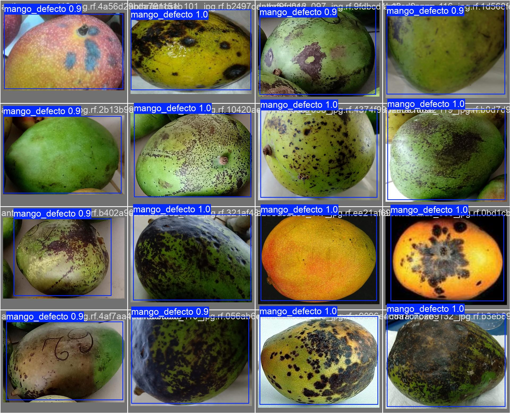
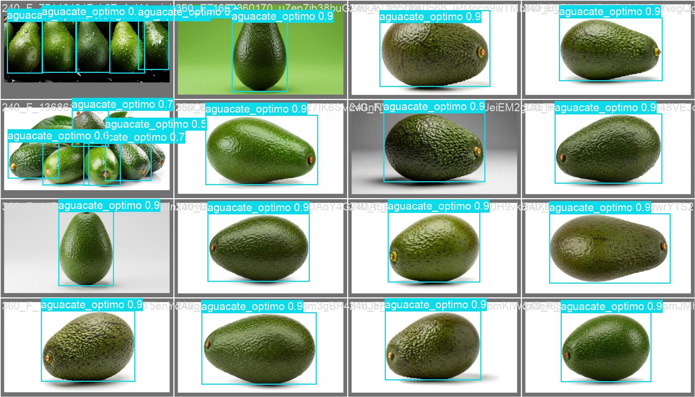
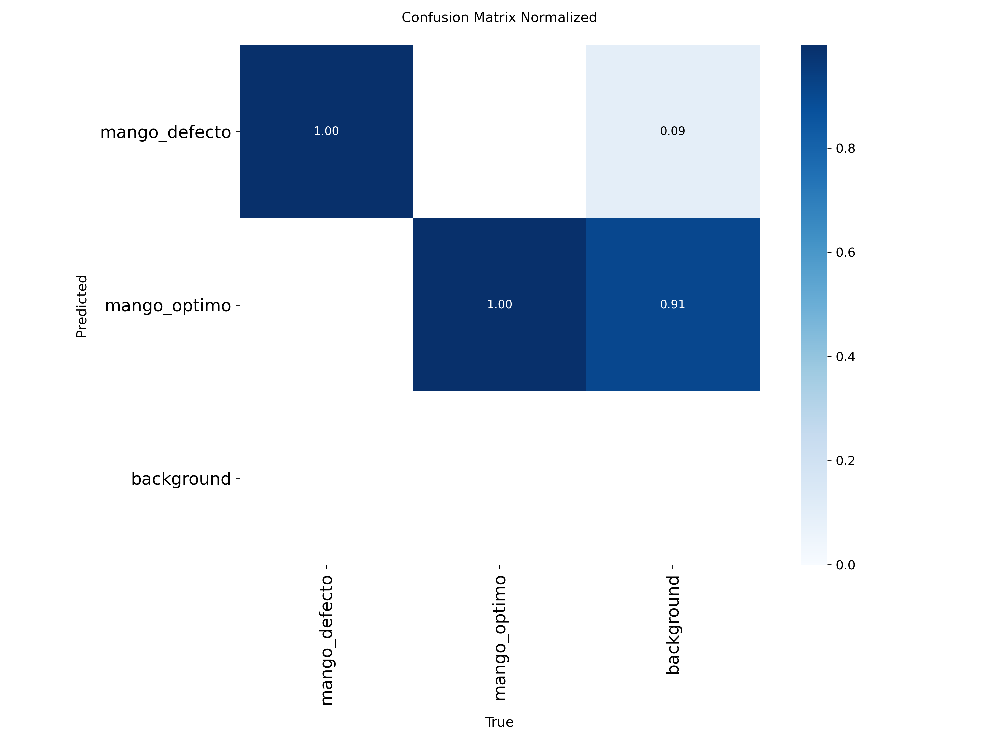
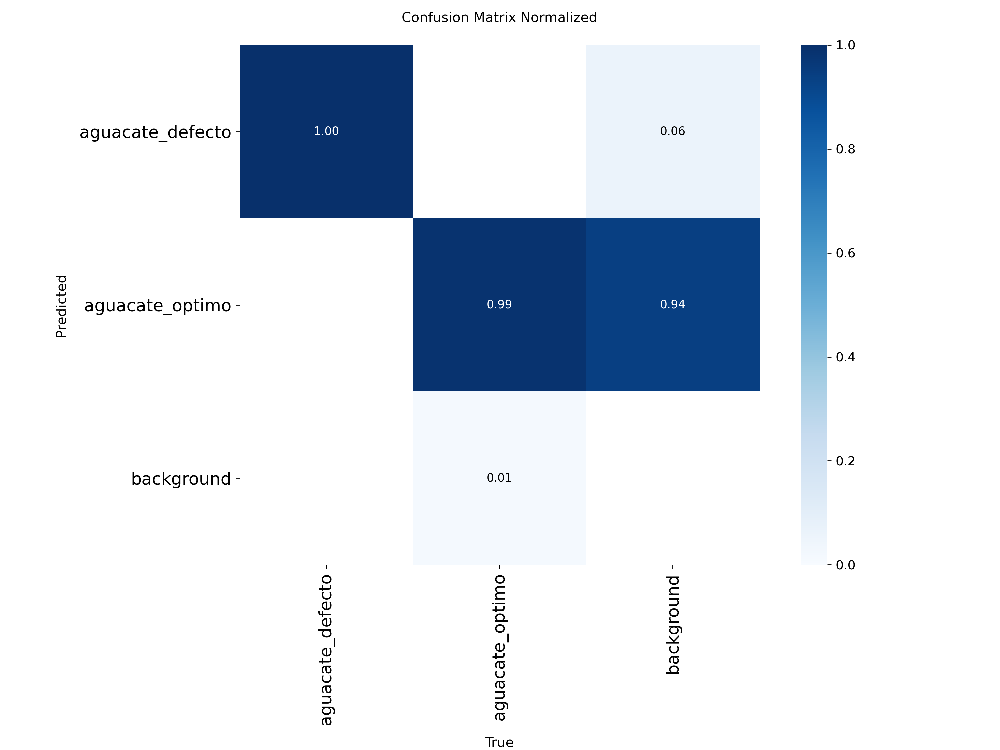
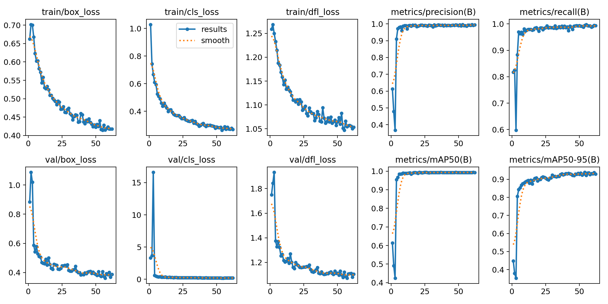
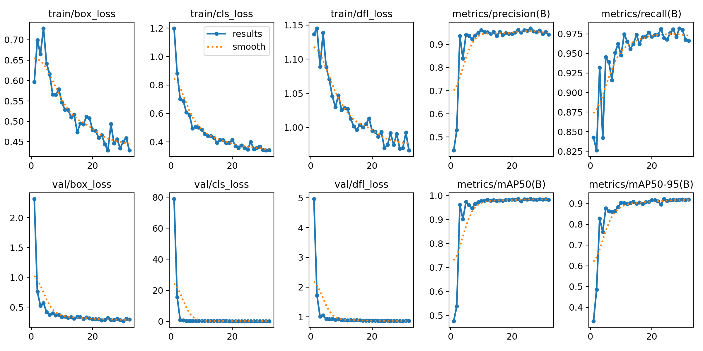

<div align="center">

# 🥭🥑 AI Mango & Avocado Classification System

**Detección y clasificación de calidad de mangos y aguacates con visión por computador**

Sube una foto, elige la fruta y el modelo, y el sistema marca cada fruta como **óptima** o **con defecto**.


</div>

---

## ✨ Qué hace

- 🍃 **Dos frutas:** mango y aguacate.
- 🏷️ **Dos clases por fruta:** `optimo` y `defecto`.
- 🧠 **Cuatro arquitecturas** entrenadas para cada fruta, elegibles desde la interfaz:

| Modelo | Tipo | Archivo (mango / aguacate) | Tamaño |
|---|---|---|---|
| **YOLOv8m** | Una etapa, Ultralytics | `yolo_mango.pt` / `yolo_aguacate.pt` | 50 MB |
| **Faster R-CNN** (ResNet-50 FPN) | Dos etapas, torchvision | `faster_mango.pth` / `faster_aguacate.pth` | 158 MB |
| **SSDLite320** (MobileNetV3-Large) | Ligero, torchvision | `ssd_mango.pth` / `ssd_aguacate.pth` | 9 MB |
| **EfficientDet-D0** | Una etapa, `effdet` | `effdet_mango.pth` / `effdet_aguacate.pth` | 27 MB |

- 🖼️ Devuelve la imagen con las cajas dibujadas, un **JSON** con cada detección y la opción de **descargar un CSV**.

## 🚀 Puesta en marcha

```bash
# 1. Clonar
git clone https://github.com/Juandks12/AI_Mango_Avocado_Classification_System.git
cd AI_Mango_Avocado_Classification_System

# 2. Entorno virtual
python -m venv .venv
# Windows
.venv\Scripts\activate
# Linux / macOS
source .venv/bin/activate

# 3. Dependencias
pip install -r requirements.txt

# 4. Modelos entrenados (8 archivos, ~600 MB, desde el Release v1.0)
python download_assets.py

# 5. Ejecutar
python app.py
```

Luego abre **http://localhost:5000**, elige la fruta y el modelo, y sube una imagen. En [`samples/`](samples) hay una foto de cada fruta para probar.

> 💡 Los modelos pesan demasiado para el repositorio (GitHub limita a 100 MB por archivo), así que viven en el [Release v1.0](https://github.com/Juandks12/AI_Mango_Avocado_Classification_System/releases/tag/v1.0). `download_assets.py` los deja en `models/`, que es donde la app los busca.

## 🗂️ Estructura

```
AI_Mango_Avocado_Classification_System/
├── app.py                  # App web Flask: subir imagen → detectar → resultado
├── download_assets.py      # Descarga modelos (y datasets con --datasets)
├── requirements.txt        # Versiones exactas con las que se probó
├── scripts/                # Inferencia de cada arquitectura
│   ├── infer_yolo.py
│   ├── infer_faster.py
│   ├── infer_ssd.py
│   └── infer_effdet.py
├── templates/              # index.html y result.html (Bootstrap 5)
├── static/css/             # Estilos
├── training/               # Scripts de entrenamiento y preparación de datos
├── samples/                # Imágenes de ejemplo
├── docs/img/               # Gráficas del entrenamiento
├── models/                 # (se crea al descargar) pesos entrenados
└── data/                   # (opcional) datasets descargados
```

## 📊 Resultados de YOLOv8

Métricas del mejor epoch que reportó Ultralytics durante el entrenamiento:

| Fruta | Epochs | Precisión | Recall | mAP@50 | mAP@50-95 |
|---|---|---|---|---|---|
| 🥭 Mango | 62 | 0.990 | 0.992 | 0.994 | 0.901 |
| 🥑 Aguacate | 32 | 0.963 | 0.974 | 0.986 | 0.911 |

> ⚠️ El export de Roboflow solo trae la carpeta `train`, así que la validación se hizo sobre esas mismas imágenes. Las cifras son por tanto **optimistas**: sirven para comparar entrenamientos, no como precisión esperada sobre fotos nuevas.

<table>
<tr>
<th>🥭 Mango</th>
<th>🥑 Aguacate</th>
</tr>
<tr>
<td></td>
<td></td>
</tr>
<tr>
<td></td>
<td></td>
</tr>
<tr>
<td></td>
<td></td>
</tr>
</table>

## 🏋️ Reentrenar

Descarga los datasets en `data/`:

```bash
python download_assets.py --datasets
```

**YOLOv8** (formato YOLO):

```bash
python training/train_yolo.py --data data/mango.v1i.yolov8/data.yaml
python training/train_yolo.py --data data/aguacate.v1i.yolov8/data.yaml
```

**Faster R-CNN, SSDLite y EfficientDet** (formato COCO):

```bash
python training/train_multi.py --data_root data/mango.v1i.coco --model fasterrcnn
python training/train_multi.py --data_root data/mango.v1i.coco --model ssdlite
python training/train_multi.py --data_root data/mango.v1i.coco --model effdet --effdet_name tf_efficientdet_d0
```

Los pesos resultantes se copian a `models/` con el nombre de la tabla de arriba para que la app los use.

Parámetros usados en YOLOv8: `yolov8m.pt` preentrenado, hasta 100 epochs con `patience=8`, `batch=8`, `imgsz=640`.

## 📦 Datasets

| Dataset | Imágenes | Clases | Fuente |
|---|---|---|---|
| Mango | 992 | `mango_defecto`, `mango_optimo` | [Roboflow Universe](https://universe.roboflow.com/daffy-xyt5c/mango-rn6ac/dataset/1) |
| Aguacate | 823 | `aguacate_defecto`, `aguacate_optimo` | [Roboflow Universe](https://universe.roboflow.com/daffy-xyt5c/aguacate-ild7x/dataset/1) |

Ambos se publican bajo licencia **CC BY 4.0** y están en el Release en formato YOLOv8 y COCO.

## 🔌 Respuesta de la app

Cada predicción guarda un JSON en `static/outputs/` con esta forma:

```json
{
  "input_path": "static/uploads/20251125T141050_mango.jpg",
  "model_path": "models/yolo_mango.pt",
  "timestamp_utc": "2025-11-25T14:10:51Z",
  "num_detections": 1,
  "predictions": [
    { "id": 1, "category_id": 1, "category_name": "mango_optimo",
      "bbox": [34.0, 51.2, 210.5, 198.3], "score": 0.94 }
  ]
}
```

`bbox` va en formato `[x, y, ancho, alto]` en píxeles. El botón **Download CSV** de la página de resultados exporta la misma información en tabla.

---

<div align="center">
Hecho con 🧠 y 🥭 por <a href="https://github.com/Juandks12">Juandks12</a>
</div>
